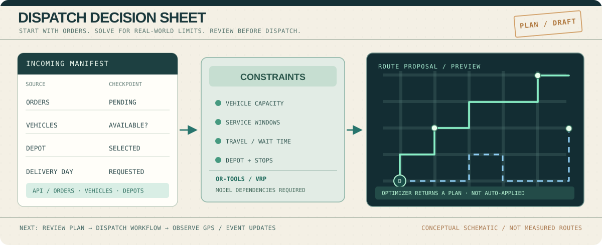

### FLEETFLOW / THE DISPATCH ATLAS

**A city of constraints. A network of decisions.**

An engineering exploration of **vehicle routing, event-driven logistics and operational visibility**—from a depot's incoming orders to a route proposal a dispatcher can inspect.

[**Explore the project**](https://fleet-flow-rho.vercel.app) · [**Dispatch decision sheet**](#the-dispatch-decision) · [**Source evidence**](#under-the-hood) · [**Run locally**](#start-a-local-dispatch)

These routes are hand-drawn conceptual geometry—not live GPS tracks, actual distances, or solver output.

---

## 01 / The dispatcher’s problem

At the beginning of a delivery shift, a dispatcher has a moving puzzle: **orders, stops, drivers, vehicle capacity, promised windows and the map between them**.

An ordinary map shows where the trucks are. A dispatch system must also answer **which jobs should go together, in what order, with what constraints—and what to do when circumstances change**.

FleetFlow investigates both sides of that problem: a *planning path* for route optimization, and an *observation path* for locations and operational events.

> **The central idea:** routing is a decision under constraints, not a decorative polyline.

### A simulated shift, not a performance claim

| Dispatch moment | Engineering question | Where to inspect |
| :--- | :--- | :--- |
| **Manifest arrives** | What orders, depots, drivers and vehicles exist? | [Orders API](backend/src/api/routes/orders.py) · [Vehicle models](backend/src/models/vehicle.py) |
| **Constraints become real** | Which loads and time windows must the solution respect? | [OR-Tools route solver](ml/route_optimizer.py) |
| **A route is proposed** | Can a request produce a feasible candidate plan? | [Optimization API](backend/src/api/routes/optimization.py) |
| **The fleet starts moving** | Can location events reach the tracking interface? | [GPS consumer](backend/src/consumers/gps_consumer.py) · [WebSocket server](backend/src/websocket_server.py) |
| **Conditions change** | How might deviations, late arrivals or hotspots be detected? | [Event processing module](data-engineering/flink/stream_processor.py) |

**Status note:** these paths exist in the repository, but their combined behaviour has not been freshly verified in a running full-stack environment. The event-processing module describes itself as a simplified Python approach, *not* a production Flink deployment.

## The dispatch decision

An architectural worksheet, not a screenshot or measured route. The current optimization API returns route proposals rather than persisting an approved dispatch.

The route engine has a concrete implementation path:

1. **Choose a depot and date.** Load the available vehicles and pending orders.
2. **Apply constraints.** Model capacity, depot location, route duration and service windows with OR-Tools.
3. **Solve for a candidate.** Compute and return routes when the dependencies and input data permit it.
4. **Inspect before applying.** The optimization endpoint returns route proposals and summary fields; it does not automatically commit the resulting dispatch to the database.

The optimizer uses an approximate distance/time calculation in the current source; OSRM has a **separate optional local routing profile**, not a verified dependency of every solver run. See [route optimizer](ml/route_optimizer.py), [optimization route](backend/src/api/routes/optimization.py) and [local-stack notes](docs/local-stack.md).

## 02 / Inside the control room

<table>
<tr>
<td width="50%" valign="top">

### 🗺️ Route surfaces

The web interface includes a fleet map, driver lists, orders, operational panels and a dedicated demo view. Map layers use **sample routes and stops**, with a hook intended to receive vehicle locations via WebSocket.

**Code:** [Live fleet map](frontend/src/components/map/live-fleet-map.tsx) · [Demo dashboard](frontend/src/app/demo/page.tsx)

</td>
<td width="50%" valign="top">

### 📦 Route planning

Python's OR-Tools models investigate vehicle routing with capacity and time constraints. FastAPI exposes an optimization request; a tRPC router provides a frontend-facing bridge.

**Code:** [VRP solver](ml/route_optimizer.py) · [tRPC bridge](frontend/src/server/routers/optimization.ts)

</td>
</tr>
<tr>
<td width="50%" valign="top">

### 📡 Events and telemetry

The repository contains Kafka event models, producers/consumers, a dedicated WebSocket server, and a simplified Python event processor for alerts and deviations.

**Code:** [Event producer](backend/src/events/producer.py) · [WebSocket server](backend/src/websocket_server.py) · [Stream processor](data-engineering/flink/stream_processor.py)

</td>
<td width="50%" valign="top">

### 📊 Research and operations data

Data warehouse models, batch workflow definitions, forecasting code and monitoring configurations explore a fuller operational platform.

**Code:** [dbt models](data-engineering/dbt/models/) · [Airflow workflows](data-engineering/airflow/dags/) · [Forecasting](ml/forecasting.py)

</td>
</tr>
</table>

### Live site vs the local workshop

| Environment | What it is |
| :--- | :--- |
| **Hosted project website** | A lightweight, portfolio-oriented frontend experience. Some routes/stops are fixtures; live backend availability is **not independently verified here**. |
| **Core local environment** | Docker, Python and Next.js services, driven by project scripts and environment variables. Requires time, memory and working dependencies. |
| **Optional heavy profiles** | Airflow, Flink, MLflow and OSRM have Compose/script configuration; adding their files does not itself prove each integration is healthy. |
| **Quality/readiness standard** | [Strict local readiness gates](docs/local-readiness.md) describe what would need to pass before the full environment should be called validated. |

The frontend's demo banner checks a health endpoint, but a positive health response **does not on its own prove that Kafka, routing and WebSocket streams are all connected**.

## Under the hood

Rather than advertising unsupported numbers, here's the source evidence for what exists.

| Operational concern | Relevant implementation |
| :--- | :--- |
| Order state, route state and drivers | [FastAPI routes](backend/src/api/routes/) · [Database models](backend/src/models/) |
| Optimization | [OR-Tools VRP](ml/route_optimizer.py) · [API entry](backend/src/api/routes/optimization.py) |
| Type-safe frontend API | [tRPC routers](frontend/src/server/routers/) · [FastAPI client](frontend/src/lib/fastapi-client.ts) |
| Event backbone | [Event models](backend/src/events/models.py) · [Kafka consumers](backend/src/consumers/) |
| Telemetry | [WebSocket server](backend/src/websocket_server.py) · [Tracking hook](frontend/src/hooks/useWebSocket.ts) |
| Geospatial and time-series schemas | [PostGIS schema](db/init/01_postgis_schema.sql) · [TimescaleDB schema](db/init/02_timescale_schema.sql) |
| Data engineering | [Airflow](data-engineering/airflow/dags/) · [dbt](data-engineering/dbt/models/) · [Stream-processing code](data-engineering/flink/) |
| Observability and validation | [Monitoring](monitoring/) · [Backend tests](backend/tests/) · [Validation script](scripts/validate-local.sh) |

### Technology set

**Interface:** Next.js 16, React 19, TypeScript, Tailwind CSS 4, tRPC, MapLibre/deck.gl.  
**API and routes:** Python, FastAPI, SQLAlchemy, OR-Tools.  
**Event/data architecture:** Kafka, WebSocket, PostgreSQL/PostGIS, TimescaleDB, Redis and optional local services.  
**Research and operations:** forecasting/ML scripts, Airflow/dbt models, monitoring configurations and test tooling.

This is an **implementation inventory**, not a guarantee that all services are running in a hosted production environment.

## Start a local dispatch

For the documented local-first workflow, see [Local Full-Power Stack](docs/local-stack.md). The checked-in scripts are designed to start the infrastructure, backend, frontend and WebSocket server in a development environment.

**Requirements:** Docker/Compose, Node.js compatible with the frontend's Next.js version, pnpm, Python 3.11 for the provided bootstrap, free ports and resources for the services you select.

~~~bash
git clone https://github.com/HuLaxx/FleetFlow.git
cd FleetFlow

# Inspect example configuration before running:
cp .env.example .env

# macOS/Linux — starts the local development workflow
./scripts/run-local.sh
~~~

Windows PowerShell: \`.\scripts\run-local.ps1\`. For infrastructure only: \`./scripts/dev-up.sh\`. Ports may be selected automatically and recorded in \`.env.ports\`.

**Important:** OSRM's routing profile requires a generated dataset; [OSRM bootstrap](scripts/osrm-bootstrap.sh) is a separate step. Other provider credentials and seed data may also be required. See [Local setup](docs/local-stack.md).

### Reproducible quality gates

FleetFlow has a strict validation script and documented criteria covering service health, deterministic seed/replay, training, testing and observability.

~~~bash
# Linux/macOS — may start multiple services and run resource-heavy checks
./scripts/validate-local.sh
~~~

See the exact [readiness conditions](docs/local-readiness.md) and [backend test modules](backend/tests/). **The validator and test suites were not executed during this README redesign**, so no current pass rate or benchmark is claimed.

## Where the route still needs work

The old README listed figures such as faster deliveries, fuel savings and sub-second re-routing, but I found no reproducible experiment here that justified presenting those percentages as actual results. They are intentionally **not** used as achieved metrics in this edition.

- [x] Route and constraint modeling code exists, alongside a route-preview API.
- [x] Demo dashboard, map visualization, event modules and local stack scripts exist.
- [x] Document sample map geometry and differentiate local services from hosted demonstration.
- [ ] Confirm end-to-end API and tRPC behaviour with seeded orders, vehicles and time windows.
- [ ] Re-run the rigorous local readiness gates and archive results.
- [ ] Check GPS event ingestion, WebSocket subscriptions and UI updates together.
- [ ] Compare routes against a repeatable baseline, reporting distance, time, costs and failed/unassigned stops.
- [ ] Validate hosted site behaviour and record authentic screenshots.
- [ ] Remove tracked Python bytecode/cache artifacts and review operational configuration before a production release.

[Read the full project roadmap](UPGRADE_PLAN.md) · [Repo-specific creative checklist](docs/CREATIVE_CHECKLIST.md)

---

### A ROUTE IS A PLAN. DISPATCH IS A DECISION.

**FleetFlow** — a HuLaX engineering project by Rahul Khanke.

[**Project site**](https://fleet-flow-rho.vercel.app) · [**Portfolio**](https://portfolio.hulax.uk/) · [**GitHub**](https://github.com/HuLaxx) · [**LinkedIn**](https://www.linkedin.com/in/rahul-khanke-853717218/)

Conceptual route graphics are not live tracking data or operational performance results.

